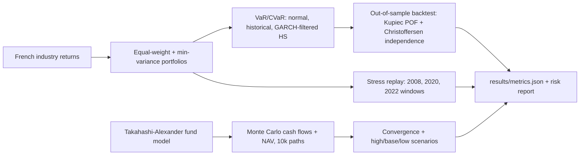

# Portfolio and Private-Fund Risk Engine

This project estimates one-day value-at-risk and expected shortfall for an equal-weight portfolio of Kenneth French's 49 industry portfolios, backtests the forecasts from 2005 through 2024, replays three stress windows, and simulates private-equity cash flows with a Takahashi-Alexander Monte Carlo model. Parametric normal VaR on a rolling one-year window is the baseline. Historical simulation and GARCH-filtered historical simulation are the alternatives. Fund paths are simulated. They are not a real fund's books.

## Setup

```text
python -m venv .venv
.venv\Scripts\pip install -r requirements.txt
```

Python 3.11 or 3.12. The run is CPU-only.

## How to run

```text
python run.py
python run.py --quick
```

`python run.py` downloads the French daily file into `data/` (cached, git-ignored), builds the 2005-2024 backtest, and writes `results/`. `python run.py --quick` runs the same steps on January-June 2016 with 400 fund paths so a smoke test can finish in a few minutes. Optional flags: `--data-dir` and `--outdir`. `--device` accepts `cpu` only.

## Architecture



## Design decisions

The backtest portfolio is the equal-weight average of the 49 value-weighted industry portfolios. That series does not depend on an estimated covariance. A long-only minimum-variance portfolio, with covariance shrunk 20% toward a scaled identity and weights refreshed every 63 trading days, is reported in the stress table and in a pre-2005 OLS beta. Weights on day t use only returns before day t.

Parametric normal VaR uses a 252-day window because that is the baseline. Historical simulation uses the same 252 days. GARCH-filtered historical simulation uses a 1000-day window and a new GARCH(1,1) fit every test day, because a 1% residual quantile is not identified by two or three tail points. The one-step variance is the `arch` forecast. Standardized residuals are the empirical innovation distribution. VaR and CVaR are positive loss numbers. A breach is `portfolio_return < -VaR`.

The labeled best method is whichever of historical simulation and filtered historical simulation has a 99% breach rate closer to 1%. Parametric normal is not eligible for that label. The label is applied after the forecasts exist. It does not change a window, a threshold, or a fund parameter. Those constants live in `src/config.py`. There is no validation slice.

The fund model is the Takahashi-Alexander recursion: call a fraction of unfunded commitment, grow NAV, add the call, distribute `max(yield, (year / life) ** bow)` of the gross amount, and carry the rest. Growth is lognormal so `1 + growth` stays positive. High, base, and low scenarios share the normal shocks and change only the expected growth rate. The contribution schedule, 12-year life, bow of 2.5, yield of 5%, and 12% base growth are a buyout-style teaching calibration, not a fit to a real fund.

`row_id` in `results/var_forecasts.csv` is the row number in the parsed value-weighted daily file, also stored in `results/dataset_index.csv`.

## Limitations

Industry portfolios are not a traded fund. There are no costs or position limits. The risk horizon is one day. A 252-day historical 99% VaR is a coarse order statistic. GARCH is univariate. A Kupiec pass does not mean breaches are independent. Fund paths are simulated classroom paths, not a client's capital account and not a historical fund's IRR.

## Data

Kenneth R. French Data Library, 49 Industry Portfolios, daily average value-weighted returns: https://mba.tuck.dartmouth.edu/pages/faculty/ken.french/data_library.html

The zip is downloaded by `src/data.py`, cached under `data/`, and checked with a SHA-256 manifest plus a minimum row count. Missing returns are the French codes -99.99 and -999. The library's terms allow use for research and education. Cash flows in the fund section are generated in code.

## Results

<!-- RESULTS_TABLE_START -->

| Criterion | Value | Rule | Passed |
| --- | --- | --- | --- |
| 99% one-day VaR breach rate of the best method, out of sample 2005-2024 | 0.0125174 | between 0.005 and 0.016 | pass |
| Kupiec POF test for the best method at 99% | 0.0841196 | >= 0.05 | pass |
| Best method vs. parametric-normal baseline | 0.0841196 | > 0.0 | pass |
| Monte Carlo convergence of fund NAV at year 5 | 0.00233716 | < 0.005 | pass |
| Cash-flow model consistency | 0 | <= 1e-08 | pass |
| Test coverage of src/ | 0.914237 | >= 0.75 | pass |

Runtime seconds: 51.121923699975014. Peak RSS GiB: 0.20495986938476562.

Breach rates and the fund standard error are copied from `results/metrics.json`.

<!-- RESULTS_TABLE_END -->

Plots written beside the metrics:

- `results/breach_rates.png`
- `results/cumulative_breaches_99.png`
- `results/var_slice.png`
- `results/fund_nav_scenarios.png`
- `results/stress_cumulative.png`
