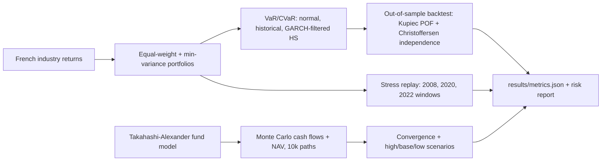

# Portfolio and Private-Fund Risk Engine - Monte Carlo Cash-Flow Projection, VaR/CVaR Backtesting, and Stress Testing

`portfolio-risk-montecarlo` · new project · estimated build effort: 5 h

## Problem

Investment and pricing teams need risk numbers they can defend: value-at-risk that passes backtests, stress scenarios, and projections of illiquid fund cash flows. This project builds a small risk engine on real public return data: it estimates VaR and CVaR for a diversified portfolio with three methods (parametric normal, historical simulation, and GARCH-filtered historical simulation), backtests them out of sample with Kupiec and Christoffersen tests, replays historical stress windows, and adds a Monte Carlo projection of private-equity fund cash flows (capital calls, distributions, NAV) using the Takahashi-Alexander model, with convergence checks and scenario (high/base/low) output.

## Target jobs and skills

- **The Beneficient Company Group (USA), L.L.C. — Financial Quantitative Analyst** (`4fecd1cc30f1`): covers 67% of the JD's weighted top skills (Python, Statistics, Probability, Simulation, Time Series, Regression, Pandas, NumPy, SciPy)

Skills/tools this project demonstrates: Python, Statistics, Probability, Simulation, Time Series, Regression, Hypothesis Testing, NumPy, Pandas, SciPy, statsmodels, Data Visualization

## Data

- **Dataset:** Kenneth R. French Data Library - 49 industry portfolios, daily and monthly returns — https://mba.tuck.dartmouth.edu/pages/faculty/ken.french/data_library.html
- **License/terms:** Freely available for research and education (Kenneth R. French Data Library terms); fund cash flows are simulated in code
- **Size used:** ~25,000 daily return rows x 49 industries (zip CSV, downloaded by script)
- **Plan:** Rolling-window estimation: each VaR forecast for day t uses only data up to t-1; the backtest covers 2005-2024 out of sample. Private-fund cash flows are simulated from documented Takahashi-Alexander parameters with fixed seeds.

## Architecture

## Tech stack

Python 3.11, NumPy, pandas, SciPy, arch (GARCH), statsmodels, matplotlib, pytest

## Deliverables

- VaR/CVaR engine with three methods behind one interface, rolling out-of-sample forecasts at 95% and 99%
- Backtest module with Kupiec proportion-of-failures and Christoffersen independence tests, breach tables and plots
- Stress-test module replaying named historical windows and a hypothetical shock scenario
- Takahashi-Alexander private-fund cash-flow simulator (capital calls, distributions, NAV) with Monte Carlo scenarios and a convergence study
- Risk report (REPORT.md) with method comparison and limitations

## Success criteria (all must hold on a from-scratch `python run.py`)

| Metric | Threshold | How it is measured |
|---|---|---|
| 99% one-day VaR breach rate of the best method, out of sample 2005-2024 | between 0.5% and 1.6% of days | rolling backtest |
| Kupiec POF test for the best method at 99% | p-value >= 0.05 | backtest module |
| Best method vs. parametric-normal baseline | best method's Kupiec p-value is higher than the normal baseline's, and the normal baseline's breach count is reported | same backtest |
| Monte Carlo convergence of fund NAV at year 5 | standard error of the mean < 0.5% of the mean with 10,000 paths | convergence study |
| Cash-flow model consistency | cumulative capital calls never exceed commitment, and NAV is non-negative on every path | property tests in pytest |
| Test coverage of src/ | >= 75% | pytest --cov |

## Evaluation artifacts (required; the evaluator recomputes metrics from these)

- results/var_forecasts.csv with columns date, portfolio_return, var95_normal, var99_normal, var95_hs, var99_hs, var95_fhs, var99_fhs (VaR as positive loss numbers; forecasts for date t use data up to t-1)
- results/fund_paths_summary.csv with columns year, nav_mean, nav_se, calls_cum_mean, dist_cum_mean, commitment
- results/fund_path_checks.json with keys max_calls_over_commitment, min_nav, n_paths

## Baseline

Parametric (normal) VaR estimated on a rolling one-year window.

## Constraints

- Runs on Windows with `python run.py` from a fresh virtualenv; no make, shell scripts, paid APIs, or accounts.
- CPU-only by default (an optional `--device cuda` flag is fine); peak RAM <= 3 GB; total downloads <= 1.5 GB.
- PyTorch (if used) pinned to the CPU wheel via `--extra-index-url https://download.pytorch.org/whl/cpu`.
- Fixed random seeds; every reported number is written by code to results/metrics.json (never typed by hand).
- Test split is created once, saved, and never used for training, tuning, or threshold selection.
- Data download is scripted (Python requests), cached under data/, and verified by checksum or row count.
- Public market data and simulated fund cash flows only; never claim real fund data, client portfolios, or trading.

## Draft resume bullets (placeholders are filled only with reproduced metrics)

- Built a VaR/CVaR engine on 20 years of real industry returns; GARCH-filtered historical simulation breached 99% VaR on [BREACH]% of days (Kupiec p = [KUPIEC_P]) vs. [NORMAL_BREACH]% for parametric normal VaR
- Simulated private-equity fund cash flows and NAV with a Takahashi-Alexander Monte Carlo model ([PATHS] paths, standard error [SE]% of mean NAV) and produced high/base/low scenarios
- Replayed 2008, 2020 and 2022 stress windows and reported portfolio losses against model VaR
